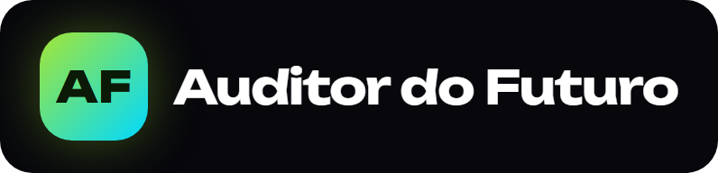

# AuditPrompter AI — Manual de Instalação e Uso

**Teleprompter e copiloto de auditoria interna ao vivo.** Este manual leva você do zero (computador sem nada instalado) até a primeira reunião com o programa funcionando, e depois mostra o uso no dia a dia.

Criado por **Jefferson Cavalcante — Auditor do Futuro** · https://aiauditor.com.br

Repositório oficial: **https://github.com/jeffersoncp21/auditprompter-ai**

---

## Como este manual está organizado

| Parte | O que você faz | Tempo aproximado |
|---|---|---|
| **1. Instalação** | Instala os programas de base e o AuditPrompter | 15 a 30 minutos |
| **2. Configurar a IA** | Escolhe quem gera os insights: Claude, Gemini ou sem API | 5 minutos |
| **3. Usar na reunião** | Prepara, captura o áudio e conduz o walkthrough | — |
| **4. Depois da reunião** | Valida riscos, gera a carta PBC e o papel de trabalho | — |
| **5. Problemas comuns** | Resolve os erros mais frequentes | — |
| **6. Dados e privacidade** | Entende onde tudo fica gravado e o que sai do computador | — |
| **7. Quem criou** | Conhece o Auditor do Futuro: treinamentos, mentoria e contato | — |

> **Leia isto primeiro.** O AuditPrompter roda **no seu computador** (Windows 10 ou 11). Ele não é um site: você instala uma vez e abre com dois cliques. As ferramentas de IA (Claude, Gemini, Antigravity) entram em dois momentos diferentes: podem **ajudar a instalar** (Parte 1) e podem ser o **motor que gera os insights** (Parte 2). Uma coisa não depende da outra.

---

# Parte 1 — Instalação do zero

## 1.1 O que você vai precisar

| Item | Para que serve | Obrigatório? |
|---|---|---|
| **Windows 10 ou 11** | Sistema onde o programa roda | Sim |
| **Google Chrome ou Microsoft Edge** | Tela do programa e captura do áudio da reunião | Sim |
| **Node.js 18 ou superior** | Faz o programa funcionar | Sim |
| **Python 3.10, 3.11 ou 3.12** | Transcrição local (Whisper) e geração de Word/Excel | Sim |
| **Git** | Baixar e atualizar pelo link do GitHub | Só nos caminhos B a E |
| **Cerca de 2 GB livres em disco** | Bibliotecas e modelo de transcrição | Sim |
| **Internet** | Na instalação e, depois, só se você usar IA em nuvem | Na instalação |

> **Sobre a versão do Python.** Prefira **3.12**. Versões muito recentes podem ainda não ter as bibliotecas de transcrição disponíveis. Este manual foi validado com Python 3.10.

## 1.2 Escolha o seu caminho de instalação

Todos os caminhos chegam ao mesmo resultado. Escolha **um**.

| Caminho | Para quem é | O que você digita |
|---|---|---|
| **A — Manual** | Quem não usa nenhuma ferramenta de IA no computador | Quase nada: baixa, descompacta e dá dois cliques |
| **B — Com o Claude Code** | Quem tem o Claude Code (terminal ou aplicativo) | Cola um pedido pronto |
| **C — Com o Gemini CLI** | Quem tem o Gemini CLI | Cola o mesmo pedido pronto |
| **D — Com o Antigravity** | Quem usa a IDE Antigravity, do Google | Cola o mesmo pedido pronto |
| **E — Com o Codex ou outra ferramenta** | Quem usa o Codex (OpenAI), o Cursor ou outro assistente que executa comandos | Cola o mesmo pedido pronto |

> **E o Claude.ai ou o Gemini no navegador?** As versões de **chat no navegador** (claude.ai, gemini.google.com) não conseguem instalar nada no seu computador. Se você só tem essas, siga o **Caminho A** — e, na Parte 2, veja como usá-las como motor de IA sem pagar API.

---

## 1.3 Caminho A — Instalação manual

### Passo 1 — Instale o Node.js

Acesse **https://nodejs.org/pt/download**, role até o fim da página e clique em **Windows Instalador (.msi)** (marcação **1**). Abra o arquivo baixado e avance com **Next** até **Finish**, sem mudar nenhuma opção.

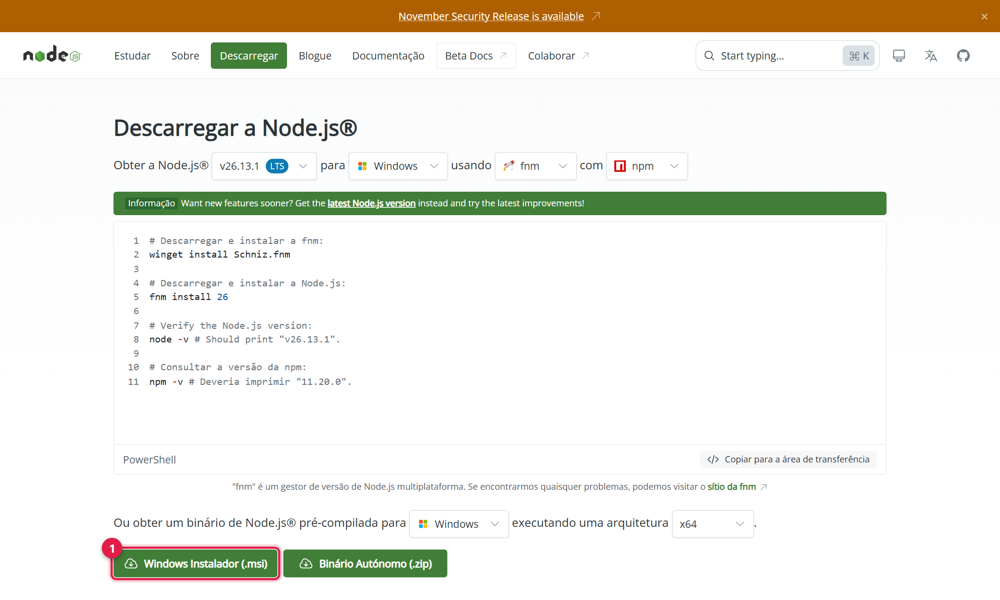

### Passo 2 — Instale o Python

O jeito mais simples é pelo próprio Windows. Abra o menu Iniciar, digite **PowerShell**, abra-o, cole o comando abaixo e pressione Enter:

```
winget install Python.Python.3.12
```

Se preferir baixar pelo site, acesse **https://www.python.org/downloads/windows/**, localize a versão **3.12** na lista e baixe o **Windows installer (64-bit)**. O botão amarelo da página inicial oferece sempre a versão mais nova, que pode ainda não ser compatível com as bibliotecas de transcrição.

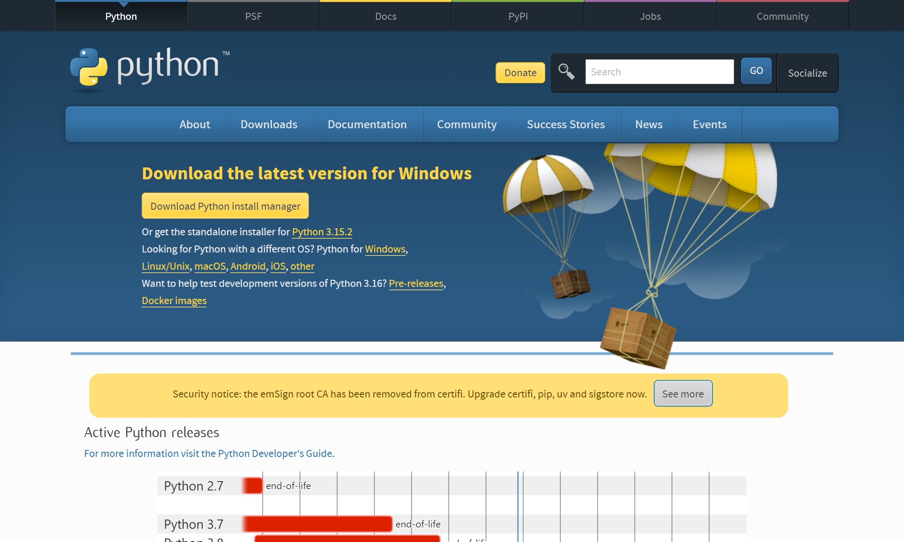

> **Atenção — o passo que mais causa erro.** Se instalar pelo site, na primeira tela do instalador marque a caixa **"Add python.exe to PATH"** antes de clicar em **Install Now**. Sem isso, o AuditPrompter não encontra o Python e a transcrição e os relatórios não funcionam.

**O Node.js também pode ser instalado pelo PowerShell,** no lugar do Passo 1:

```
winget install OpenJS.NodeJS.LTS
```

Depois de instalar, **feche e abra de novo** o PowerShell para que os programas sejam reconhecidos.

### Passo 3 — Confira se os dois foram instalados

No PowerShell, digite cada comando e pressione Enter:

```
node -v
```

```
python --version
```

Cada um deve responder com um número de versão (por exemplo `v22.11.0` e `Python 3.12.7`). Se aparecer "não é reconhecido", veja a Parte 5.

### Passo 4 — Baixe o AuditPrompter pelo GitHub

Acesse **https://github.com/jeffersoncp21/auditprompter-ai**, clique no botão verde **Code** (marcação **1**) e depois em **Download ZIP** (marcação **2**).

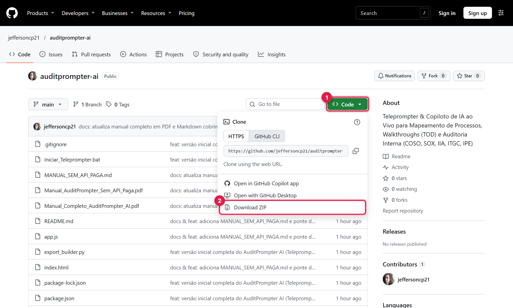

Em seguida:

- Abra a pasta **Downloads**, clique com o botão direito no arquivo `auditprompter-ai-main.zip` e escolha **Extrair tudo**.
- Mova a pasta extraída para um lugar fixo, por exemplo **Documentos**.

> **Dica.** Evite deixar a pasta do programa dentro do OneDrive ou do Google Drive. Os dados das suas reuniões **não** ficam nessa pasta (veja a Parte 6), mas a sincronização pode travar arquivos durante a instalação.

### Passo 5 — Abra o programa pela primeira vez

Dentro da pasta, dê **dois cliques** em **`Iniciar_Teleprompter.bat`**.

- Se o Windows mostrar "O Windows protegeu o computador", clique em **Mais informações** e depois em **Executar assim mesmo**.
- Uma janela preta se abre e instala as bibliotecas sozinha. **Na primeira vez isso leva alguns minutos** — aguarde sem fechar.
- Ao terminar, o navegador abre em **http://localhost:3000** com o programa pronto.

> **Não feche a janela preta enquanto estiver usando o programa.** Ela é o "motor" do AuditPrompter. Para encerrar o programa, basta fechá-la.

Você verá esta tela:

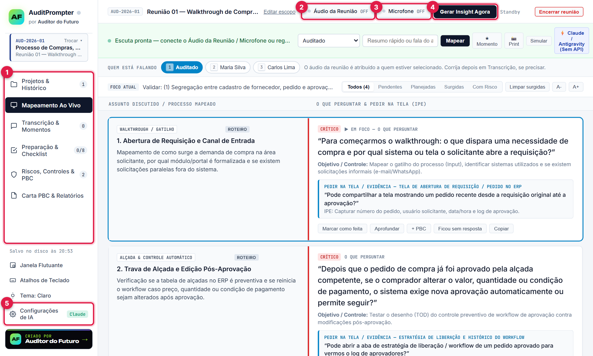

- **1** — Menu das áreas do programa.
- **2** — Liga a captura do áudio da reunião (fala dos entrevistados).
- **3** — Liga o seu microfone (suas perguntas).
- **4** — Gera um insight na hora, sem esperar a pausa na fala.
- **5** — Configurações de IA e de transcrição.

**Instalação concluída.** Siga para a Parte 2.

---

## 1.4 Caminho B — Instalar com o Claude Code

O Claude Code executa os comandos de instalação por você.

### Passo 1 — Tenha o Claude Code instalado

Se ainda não tem, instale o Node.js (Passo 1 do Caminho A) e rode no PowerShell:

```
npm install -g @anthropic-ai/claude-code
```

Quem usa o **aplicativo do Claude para computador** pode usar a aba **Code**, sem instalar nada pelo terminal.

### Passo 2 — Abra o Claude Code na pasta onde quer instalar

No PowerShell:

```
cd $HOME\Documents
```

```
claude
```

### Passo 3 — Cole o pedido de instalação

Copie o texto do quadro **"Pedido pronto de instalação"** (seção 1.8) e cole na conversa. O Claude vai pedir autorização antes de rodar cada comando: leia e aprove.

### Passo 4 — Abra o endereço informado

Ao final, o Claude informa que o programa está em **http://localhost:3000**. Abra esse endereço no Chrome ou no Edge.

---

## 1.5 Caminho C — Instalar com o Gemini CLI

### Passo 1 — Tenha o Gemini CLI instalado

Com o Node.js instalado, rode no PowerShell:

```
npm install -g @google/gemini-cli
```

### Passo 2 — Abra o Gemini CLI na pasta onde quer instalar

```
cd $HOME\Documents
```

```
gemini
```

Na primeira vez ele pede para você entrar com a sua conta Google.

### Passo 3 — Cole o pedido de instalação

Copie o **"Pedido pronto de instalação"** (seção 1.8), cole na conversa e aprove os comandos que ele propuser.

### Passo 4 — Abra o endereço informado

Abra **http://localhost:3000** no Chrome ou no Edge.

---

## 1.6 Caminho D — Instalar com o Antigravity

### Passo 1 — Abra o Antigravity

Instale o Antigravity pelo site oficial do Google, caso ainda não tenha, e abra o programa.

### Passo 2 — Abra uma pasta de trabalho

Use **File → Open Folder** e escolha a pasta **Documentos** (o AuditPrompter será criado dentro dela).

### Passo 3 — Cole o pedido de instalação no painel do agente

Abra o painel de conversa com o agente, cole o **"Pedido pronto de instalação"** (seção 1.8) e aprove os comandos.

### Passo 4 — Abra o endereço informado

Abra **http://localhost:3000** no Chrome ou no Edge.

> **Vantagem deste caminho.** O Antigravity também pode ser o motor de IA do AuditPrompter sem custo de API (seção 2.4).

---

## 1.7 Caminho E — Instalar com o Codex ou outra ferramenta

Qualquer assistente de programação que **execute comandos no seu computador** consegue instalar o AuditPrompter com o mesmo pedido pronto: Codex (OpenAI), Cursor, Windsurf, GitHub Copilot no modo agente, entre outros.

### Passo 1 — Abra a ferramenta na pasta onde quer instalar

No caso do Codex, com o Node.js instalado, rode no PowerShell:

```
npm install -g @openai/codex
```

```
cd $HOME\Documents
```

```
codex
```

Nas ferramentas em formato de editor (Cursor, Windsurf), abra a pasta **Documentos** e o painel de conversa com o agente.

### Passo 2 — Cole o pedido de instalação

Cole o **"Pedido pronto de instalação"** (seção 1.8) e aprove os comandos propostos.

### Passo 3 — Abra o endereço informado

Abra **http://localhost:3000** no Chrome ou no Edge.

> **Instalar é diferente de gerar os insights.** Qualquer uma dessas ferramentas serve para **instalar**. Já como **motor de IA dentro do programa**, a ligação direta por chave de API existe só para o **Claude** e o **Gemini**. As demais (Codex, ChatGPT, Cursor…) funcionam pela **ponte sem API**, explicada na seção 2.4.

## 1.8 Pedido pronto de instalação (caminhos B, C, D e E)

Copie o texto abaixo inteiro e cole na ferramenta de IA:

```
Instale e inicie o AuditPrompter neste computador (Windows) a partir do
repositório https://github.com/jeffersoncp21/auditprompter-ai

1. Verifique se Node.js 18+, Python 3.10 a 3.12 e Git estão instalados
   (node -v, python --version, git --version). Se faltar algum, instale
   com winget (OpenJS.NodeJS.LTS, Python.Python.3.12, Git.Git) e me avise
   se eu precisar reabrir o terminal.
2. Clone o repositório na pasta Documentos\auditprompter-ai. Se a pasta
   já existir, apenas atualize com git pull.
3. Dentro da pasta, rode: npm install
   e depois: python -m pip install -r requirements.txt
4. Confirme a instalação com:
   python -c "import faster_whisper, docx, openpyxl; print('ok')"
5. Inicie com: npm start
   Deixe rodando e me diga o endereço que abriu (http://localhost:3000).

Não altere nenhum arquivo do projeto. Não peça nem grave chaves de API:
eu configuro isso na tela do próprio programa.
```

## 1.9 Como abrir o programa nos outros dias

Em qualquer caminho, depois de instalado basta dar **dois cliques em `Iniciar_Teleprompter.bat`** dentro da pasta do programa. Vale criar um atalho na Área de Trabalho: botão direito no arquivo → **Enviar para → Área de trabalho (criar atalho)**.

---

# Parte 2 — Configurar a IA

Clique em **Configurações de IA**, no canto inferior esquerdo. Há duas escolhas independentes: **quem transcreve o áudio** e **quem gera os insights**.

## 2.1 Transcrição do áudio: mantenha o Whisper local

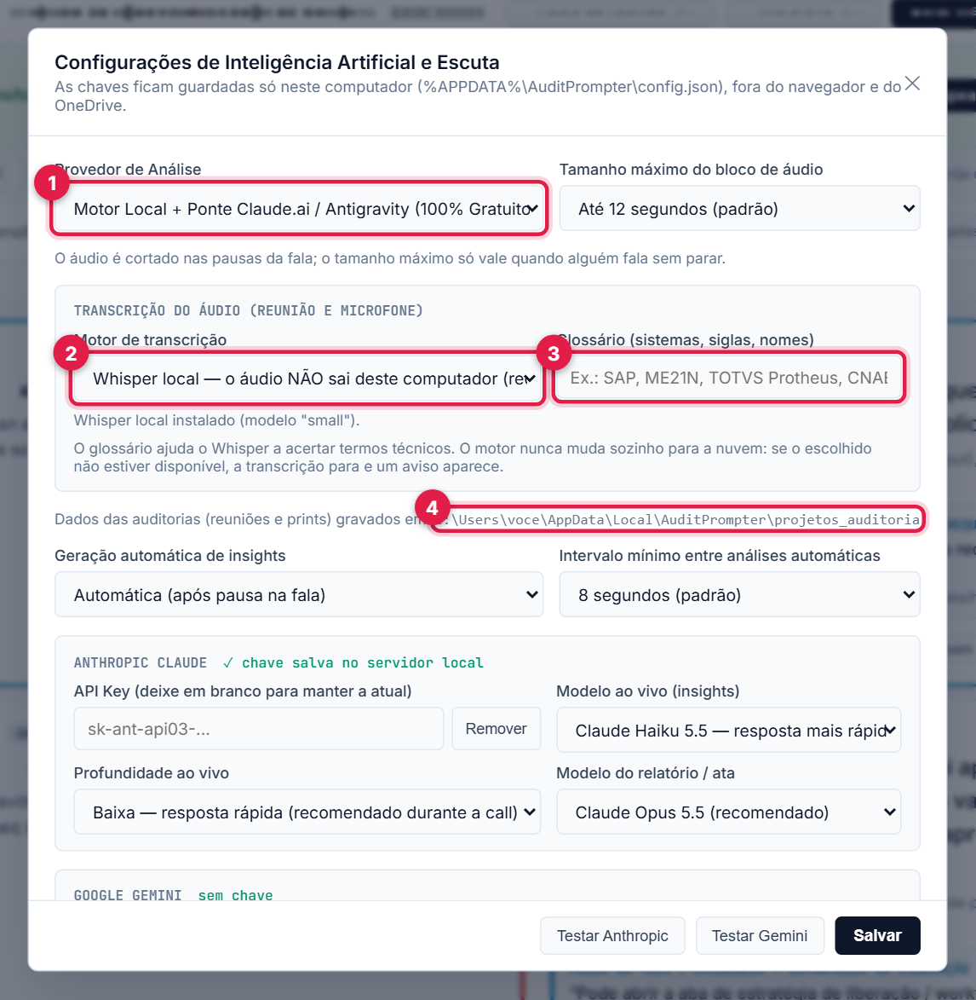

- **1 — Provedor de Análise.** Quem lê a transcrição e sugere perguntas, riscos e controles (seções 2.2 a 2.4).
- **2 — Motor de transcrição.** Deixe em **Whisper local**: o áudio é transcrito no seu computador e **não é enviado à internet**. As outras duas opções enviam o áudio ao Google.
- **3 — Glossário.** Digite nomes de sistemas, siglas e pessoas (ex.: `SAP, ME21N, Protheus, CNAB`). Isso melhora muito o acerto da transcrição em termos técnicos.
- **4 — Pasta de dados.** Onde as reuniões e os prints ficam gravados.

> **Primeira transcrição.** Na primeira vez que o Whisper é usado, o modelo (cerca de 460 MB) é baixado uma única vez. Depois disso a transcrição funciona sem internet.

## 2.2 Opção 1 — Claude (Anthropic), com chave de API

A opção mais automática: os insights aparecem sozinhos a cada pausa na fala.

- Acesse **https://console.anthropic.com**, entre em **API Keys** e crie uma chave (começa com `sk-ant-`). É preciso ter créditos em **Billing**.
- No AuditPrompter, em **Provedor de Análise**, escolha **Anthropic Claude**.
- Cole a chave no campo **1**, clique em **Testar Anthropic** (**4**) e depois em **Salvar** (**5**).

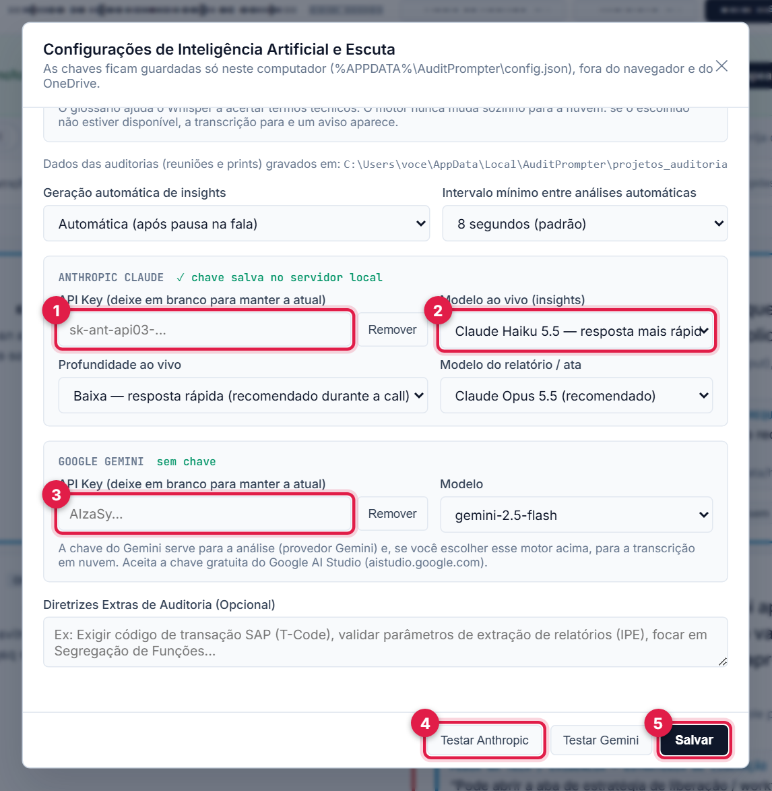

- **2 — Modelo ao vivo.** O padrão é o **Claude Haiku 5.5**, o mais rápido. Se quiser perguntas mais elaboradas e aceitar esperar um pouco mais, troque para Sonnet ou Opus.
- O **modelo do relatório / ata** vem como **Claude Opus 5.5** e não precisa ser alterado.

## 2.3 Opção 2 — Gemini (Google), com chave de API

- Acesse **https://aistudio.google.com/apikey** e clique em **Create API Key** (a chave começa com `AIzaSy`). Há um nível gratuito com limite de uso.
- No AuditPrompter, em **Provedor de Análise**, escolha **Google Gemini**.
- Cole a chave no campo **3** da imagem acima, clique em **Testar Gemini** e depois em **Salvar**.

## 2.4 Opção 3 — Sem pagar API

Em **Provedor de Análise**, escolha **Motor Local + Ponte Claude.ai / Antigravity**. Você passa a ter três recursos, que podem ser combinados:

**a) Motor local (automático).** Regras internas reconhecem situações clássicas — aprovação fora do sistema, conflito de segregação de funções, planilha manual sem revisão, usuário compartilhado — e sugerem a pergunta e a evidência. Funciona sozinho e nada sai do computador, mas é mais limitado que uma IA.

**b) Ponte com o Claude.ai ou o Gemini no navegador.** Na tela **Mapeamento Ao Vivo**, clique em **⚡ Claude / Antigravity (Sem API)**:

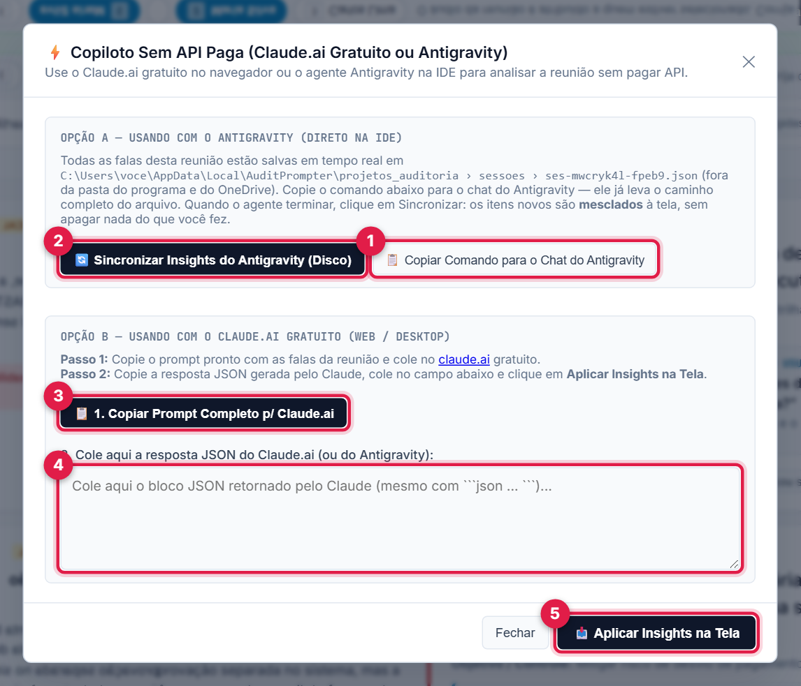

- Clique em **Copiar Prompt Completo** (**3**) — ele leva o contexto e as falas recentes.
- Cole no **claude.ai** (ou no chat do Gemini) e envie.
- Copie a resposta, cole no campo **4** e clique em **Aplicar Insights na Tela** (**5**).

**c) Ponte com o Antigravity.** Na mesma janela:

- Clique em **Copiar Comando para o Chat do Antigravity** (**1**) — o comando já leva o caminho completo do arquivo da reunião.
- Cole no painel do agente do Antigravity e aguarde ele terminar.
- Clique em **Sincronizar Insights do Antigravity** (**2**). Os itens novos são **somados** à tela; nada do que você fez é apagado.

**d) Outras ferramentas (ChatGPT, Codex, Cursor…).** Os botões levam os nomes "Claude" e "Antigravity", mas as duas pontes funcionam com qualquer ferramenta equivalente:

- **Ferramentas de chat** (ChatGPT, Copilot, entre outras): use a ponte **b**. O prompt copiado já pede a resposta no formato que o programa entende; basta colar a resposta de volta.
- **Ferramentas que editam arquivos no seu computador** (Codex, Cursor, Claude Code, Gemini CLI): use a ponte **c**. Cole o comando copiado na ferramenta e, quando ela terminar, clique em **Sincronizar**.

## 2.5 Comparativo: qual opção escolher

| Opção | Insights automáticos? | Custo | O que sai do computador |
|---|---|---|---|
| **Claude (API)** | Sim, em tempo real | Créditos da Anthropic | Só o **texto** transcrito |
| **Gemini (API)** | Sim, em tempo real | Gratuito com limite, ou pago | Só o **texto** transcrito |
| **Motor local** | Sim, por palavras-chave | Nenhum | **Nada** |
| **Ponte com chat** (Claude.ai, Gemini, ChatGPT) | Não — você copia e cola | Nenhum além da sua assinatura, se houver | O texto que **você** colar no chat |
| **Ponte com agente** (Antigravity, Codex, Cursor) | Não — você pede ao agente | Nenhum além da sua assinatura, se houver | O que o agente enviar ao serviço dele |

Em todas as opções, com o **Whisper local** selecionado, o **áudio** da reunião não sai do computador.

---

# Parte 3 — Usar na reunião

## 3.1 Antes da reunião: prepare o roteiro

Abra **Preparação & Checklist**.

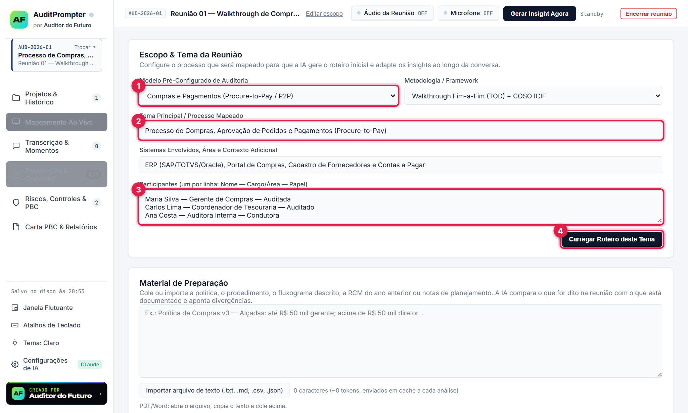

- **1 — Modelo pré-configurado.** Escolha o processo (Compras, Acessos, Vendas, Fechamento, Folha, Estoque, Fraude) ou **Personalizado**.
- **2 — Tema.** O processo que será mapeado.
- **3 — Participantes.** Um por linha, no formato `Nome — Cargo — Papel`. Quem tiver "Auditor" no cargo ou no papel é tratado como condutor; os demais viram os botões de "quem está falando".
- **4 — Carregar Roteiro.** Monta as perguntas iniciais do teleprompter.

Na mesma tela, mais abaixo, você pode colar a política ou o procedimento do processo em **Material de Preparação**. A IA passa a apontar divergências entre o que está documentado e o que for dito.

## 3.2 Ao começar: consentimento e captura do áudio

Clique em **Áudio da Reunião**. Na primeira vez em cada reunião o programa pede a confirmação de que os participantes foram avisados:

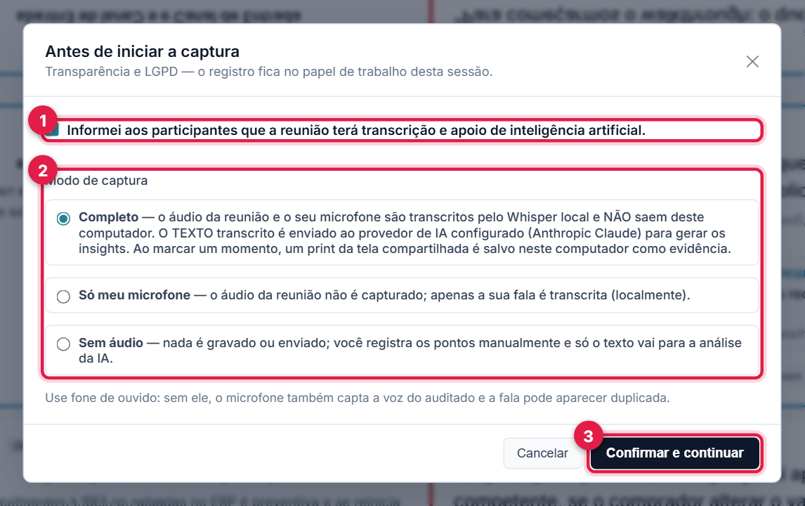

- **1** — Marque depois de **avisar os participantes** de que haverá transcrição e apoio de IA.
- **2** — Escolha o modo. O texto de cada modo informa, para a **sua** configuração, o que fica no computador e o que é enviado.
- **3** — Confirme.

Em seguida o Chrome pergunta **o que compartilhar**. Esta escolha define se o áudio será capturado:

| Onde está a reunião | O que escolher no Chrome | Caixa que precisa estar marcada |
|---|---|---|
| Teams, Meet ou Zoom **no navegador** | Aba **Guia do Chrome** e a guia da reunião | **Compartilhar também o áudio da guia** |
| Aplicativo do Teams ou Zoom **instalado** | Aba **Tela inteira** | **Compartilhar também o áudio do sistema** |

> **Atenção.** A opção **Janela** não captura áudio. Se o programa avisar "Áudio da reunião não detectado", repita escolhendo **Guia do Chrome** ou **Tela inteira** com a caixa de áudio marcada.

Depois clique em **Microfone** para registrar também as suas perguntas.

> **Use fone de ouvido.** Sem ele, o microfone capta a voz dos entrevistados pela caixa de som e as falas aparecem duplicadas.

## 3.3 Durante a reunião: a tela ao vivo

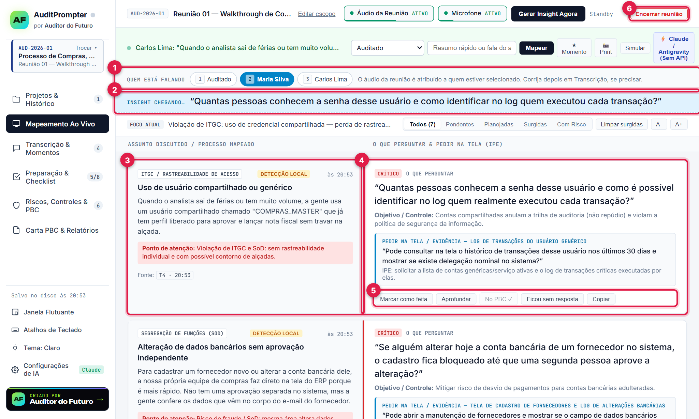

- **1 — Quem está falando.** Clique no nome de quem está com a palavra (ou use **Ctrl+Alt+1, 2, 3…**). O áudio da reunião é atribuído a essa pessoa. A troca é feita por você: o programa não reconhece vozes sozinho.
- **2 — Insight chegando.** A próxima pergunta aparece aqui enquanto a IA ainda está escrevendo o restante.
- **3 — Assunto discutido.** Resumo do que o entrevistado relatou, com o ponto de atenção e a fala de origem (ex.: `T4`). Clique na fonte para conferir a fala literal.
- **4 — O que perguntar.** A pergunta pronta para ler em voz alta e, logo abaixo, o que **pedir para mostrar na tela** e o que observar na evidência.
- **5 — Ações do cartão.** Marcar como feita, aprofundar, enviar a evidência para a lista PBC, registrar que ficou sem resposta.
- **6 — Encerrar reunião.** Veja a seção 3.5.

**Sem áudio?** Digite um resumo da fala no campo ao lado de **Mapear** e pressione Enter: o programa gera o insight do mesmo jeito.

**Trabalhando com o Teams em tela cheia?** Clique em **Janela Flutuante** (menu lateral): o teleprompter fica em uma janela pequena por cima da reunião.

## 3.4 Marque momentos e guarde prints como evidência

Quando o entrevistado mostrar algo importante na tela, clique em **★ Momento** (Ctrl+Alt+M) ou em **📸 Print** (Ctrl+Alt+S). O programa salva o quadro da tela compartilhada com data, hora, projeto e reunião.

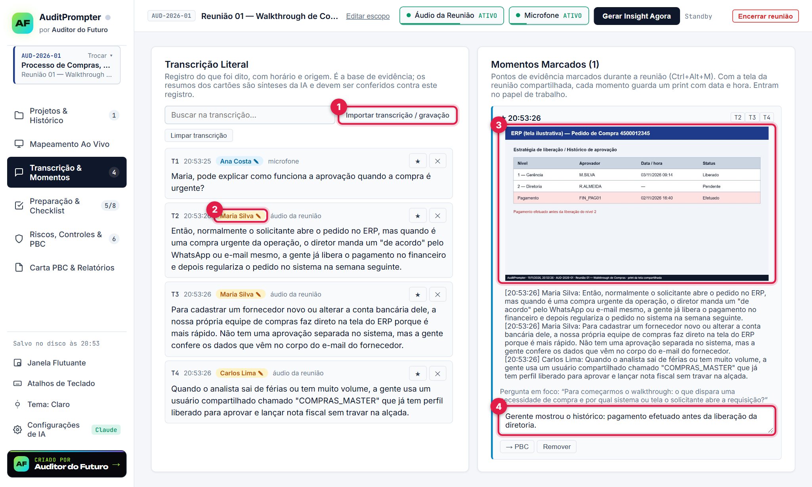

- **1 — Importar transcrição / gravação.** Para uso depois da reunião (seção 4.1).
- **2 — Corrigir quem falou.** Clique no nome para trocar o locutor de uma fala ou de um bloco seguido.
- **3 — Print da tela.** Clique para abrir em tamanho real. Ele entra no papel de trabalho.
- **4 — Anotação.** Escreva o contexto enquanto está fresco.

## 3.5 Antes de liberar os participantes: encerre a reunião

Clique em **Encerrar reunião** (Ctrl+Alt+E) **enquanto os entrevistados ainda estão presentes**.

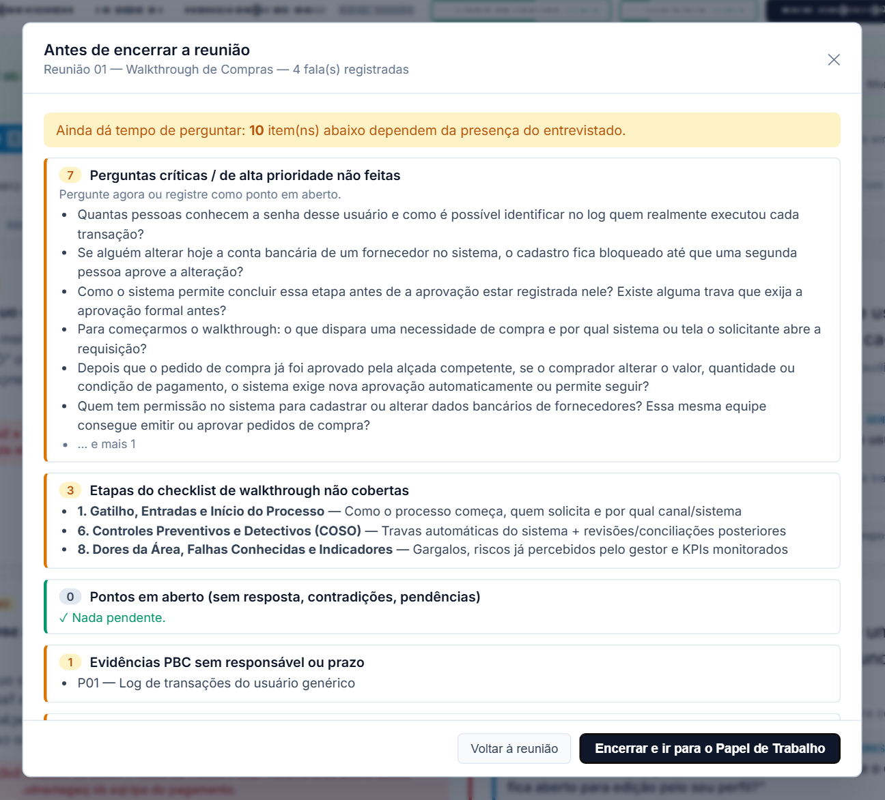

A revisão mostra o que ainda depende de quem está na sala: perguntas críticas não feitas, etapas do checklist não cobertas, pontos em aberto, evidências sem responsável ou prazo e riscos sem controle. No final há uma **fala sugerida de fechamento**.

- **Voltar à reunião** — para fazer as perguntas que faltaram.
- **Encerrar e ir para o Papel de Trabalho** — desliga a captura e registra as perguntas críticas não feitas como pontos em aberto, para o follow-up.

## 3.6 Atalhos de teclado

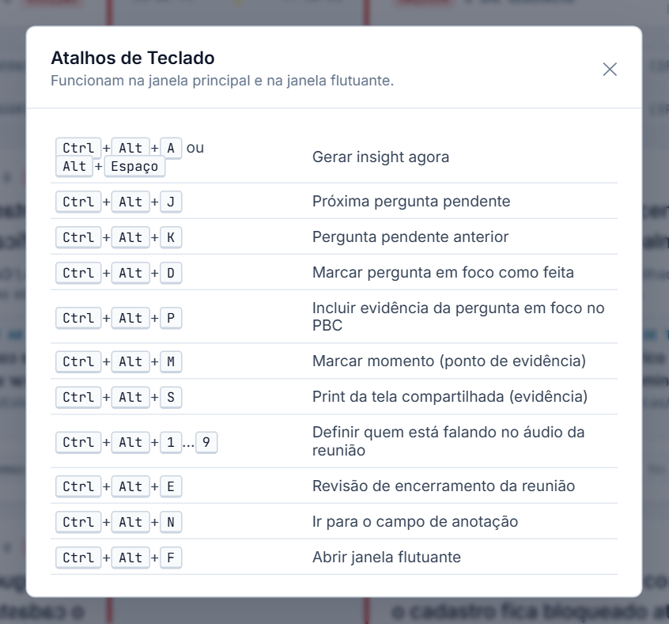

---

# Parte 4 — Depois da reunião

## 4.1 Não capturou ao vivo? Importe a transcrição ou a gravação

Em **Transcrição & Momentos**, clique em **Importar transcrição / gravação** e escolha:

- a transcrição baixada do **Teams, Zoom ou Meet** (`.vtt`, `.docx`, `.srt` ou `.txt`); ou
- a **gravação** da reunião em áudio ou vídeo (`.mp3`, `.m4a`, `.wav`, `.mp4`, `.webm`…), que é transcrita pelo Whisper local.

O programa pergunta quem é da auditoria e oferece gerar os insights, riscos e controles de uma vez:

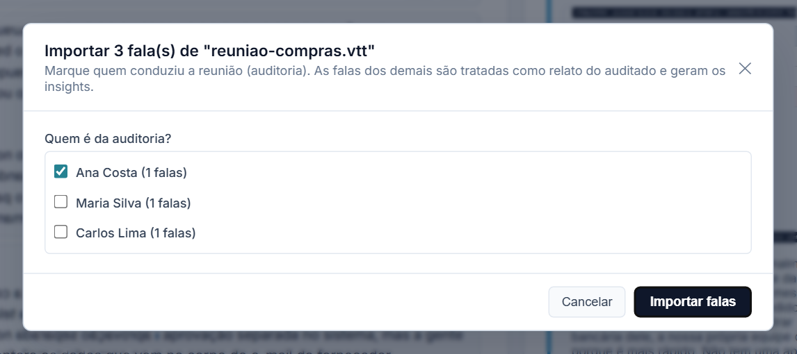

## 4.2 Revise e valide riscos, controles e evidências

Abra **Riscos, Controles & PBC**.

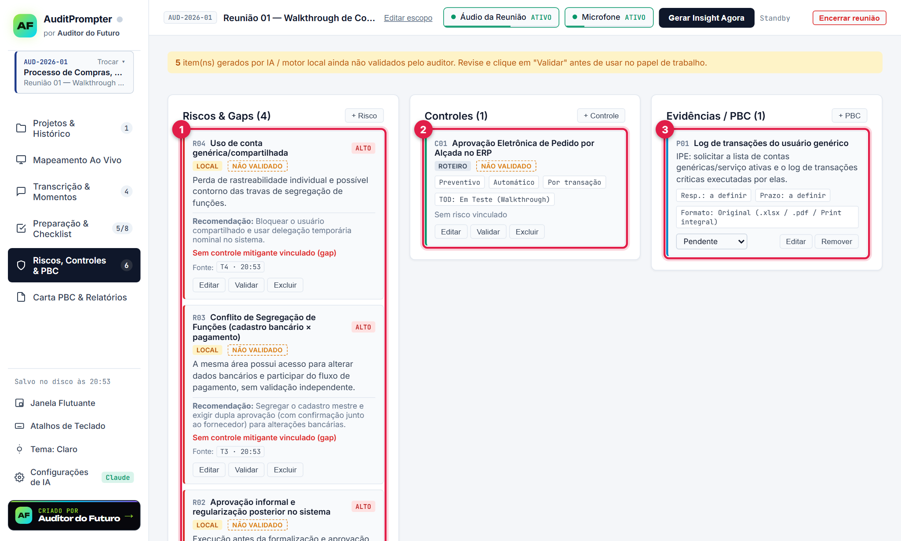

- **1 — Riscos & Gaps.** Tudo o que veio da IA ou do motor local chega como **"Não validado"**.
- **2 — Controles**, com tipo, natureza, frequência e avaliação do desenho.
- **3 — Evidências / PBC.** O que foi pedido, com responsável, prazo e status.
- **4 — Pontos em aberto.** Perguntas sem resposta, contradições e pendências.

> **Regra de ouro.** A IA sugere; quem conclui é o auditor. Confira cada item contra a transcrição literal (clique na fonte `T…`) e só então clique em **Validar**. Não leve item não validado para o relatório.

## 4.3 Gere a carta de solicitação de evidências (PBC)

Abra **Carta PBC & Relatórios**.

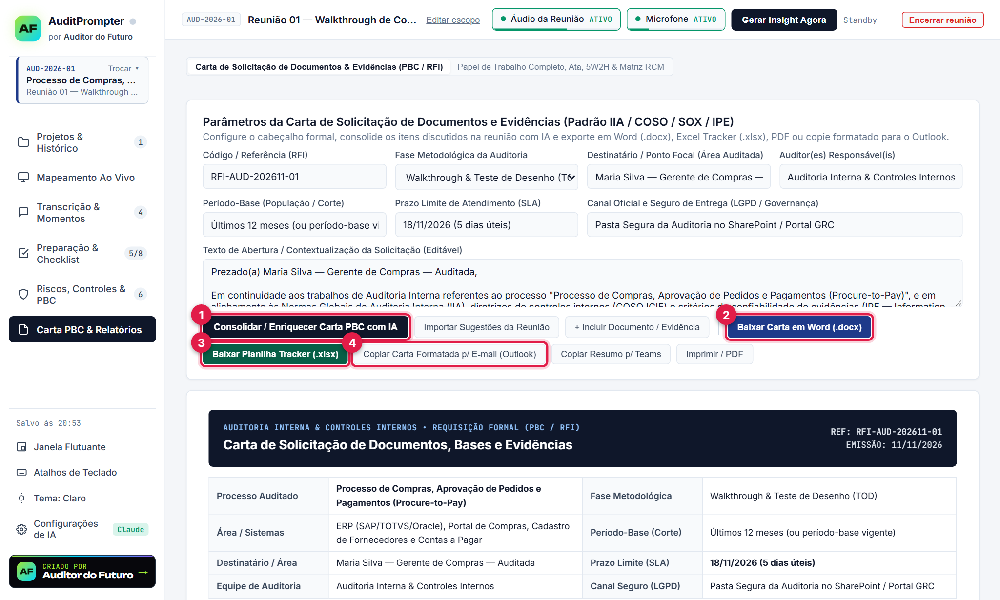

- **1** — Consolida e enriquece a carta com IA (opcional).
- **2** — Baixa a carta em **Word**.
- **3** — Baixa a planilha de acompanhamento em **Excel**, para o auditado preencher.
- **4** — Copia a carta formatada para colar no **Outlook**.

Preencha antes o cabeçalho: destinatário, período-base, prazo e canal de entrega.

## 4.4 Gere o papel de trabalho

Na mesma tela, abra a aba **Papel de Trabalho Completo**.

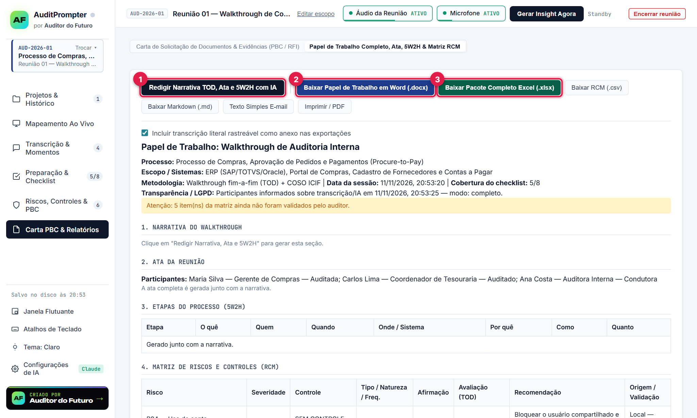

- **1** — Redige a narrativa do walkthrough, a ata e o 5W2H com IA.
- **2** — Baixa o papel de trabalho em **Word**, com os prints dos momentos marcados.
- **3** — Baixa o pacote completo em **Excel** (PBC, RCM, 5W2H, registro da reunião).

Onde a IA não tiver a informação, ela escreve **[a confirmar]**: revise esses pontos antes de usar o documento.

## 4.5 Projetos, histórico e visão consolidada

Abra **Projetos & Histórico**.

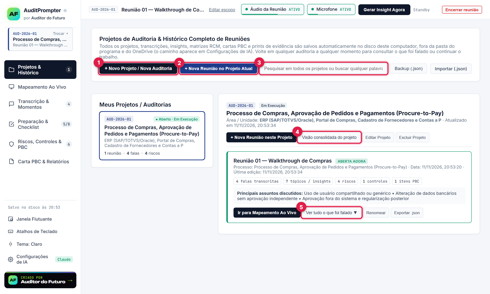

- **1 — Novo Projeto.** Uma auditoria nova, isolada das demais.
- **2 — Nova Reunião no Projeto Atual.** A reunião nova já chega com as **pendências em aberto** e o contexto das anteriores.
- **3 — Pesquisa.** Encontra qualquer palavra dita em qualquer reunião.
- **4 — Visão consolidada do projeto.**
- **5 — Ver tudo o que foi falado** em uma reunião, sem precisar abri-la.

A visão consolidada soma todas as reuniões do projeto, sem repetir riscos e controles, e exporta a matriz em CSV:

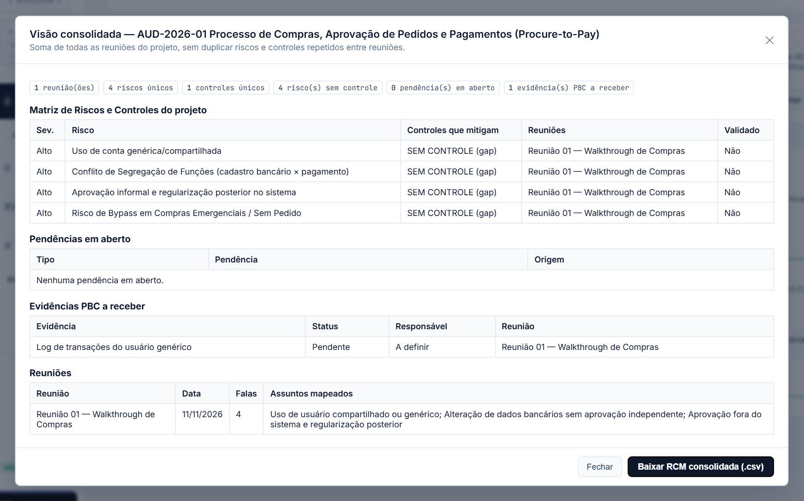

---

# Parte 5 — Problemas comuns

| O que aparece | Causa provável | Como resolver |
|---|---|---|
| `node` ou `python` "não é reconhecido" | Programa não instalado, ou o terminal estava aberto durante a instalação | Feche e abra o PowerShell. Se continuar, reinstale; no Python, marque **Add python.exe to PATH** |
| A janela preta fecha sozinha ao abrir o `.bat` | Node.js não instalado | Instale o Node.js (Parte 1) e tente de novo |
| "A porta 3000 já está em uso" | O programa já está aberto em outra janela | Use a janela que já está aberta ou feche-a antes de abrir de novo |
| A página não abre em `localhost:3000` | A janela preta foi fechada | Abra de novo o `Iniciar_Teleprompter.bat` |
| "Áudio da reunião não detectado" | A caixa de áudio não foi marcada, ou foi escolhida a opção **Janela** | Repita com **Guia do Chrome** ou **Tela inteira** e a caixa de áudio marcada (seção 3.2) |
| "O áudio NÃO está sendo transcrito: o Whisper local não está instalado" | Biblioteca de transcrição ausente | No PowerShell: `python -m pip install faster-whisper` e reabra o programa |
| A primeira transcrição demora muito | Download único do modelo (cerca de 460 MB) | Aguarde; nas próximas vezes é imediato |
| A transcrição erra nomes de sistemas e siglas | Termos fora do vocabulário comum | Preencha o **Glossário** em Configurações de IA |
| As falas aparecem duplicadas | O microfone capta o som da caixa | Use fone de ouvido |
| "Chave Anthropic recusada" ou "sem créditos" | Chave incompleta ou conta sem saldo | Copie a chave inteira; confira **Billing** no console da Anthropic |
| "IA indisponível… usando o motor local" | Falha de internet ou limite do provedor | O programa continua com o motor local; tente de novo em instantes |
| Print indisponível | A tela da reunião não está compartilhada | Ligue **Áudio da Reunião** compartilhando a guia ou a tela |
| Erro ao instalar bibliotecas do Python | Versão do Python muito nova ou muito antiga | Instale o **Python 3.12** e rode `python -m pip install -r requirements.txt` na pasta do programa |

---

# Parte 6 — Dados e privacidade

## 6.1 Onde tudo fica gravado

| O quê | Onde |
|---|---|
| Reuniões, transcrições, matrizes e prints | `C:\Users\<seu usuário>\AppData\Local\AuditPrompter\projetos_auditoria` |
| Chaves de API | `C:\Users\<seu usuário>\AppData\Roaming\AuditPrompter\config.json` |
| Programa | A pasta que você baixou do GitHub |

Os dados ficam **fora da pasta do programa** e **fora do OneDrive**. O caminho exato aparece em **Configurações de IA**. Para colar um desses caminhos no Explorador de Arquivos, use `%LOCALAPPDATA%\AuditPrompter`.

## 6.2 O que sai do computador

- **Áudio:** com o Whisper local, **nunca**. Só sai se você escolher um dos motores de nuvem do Google — e um aviso fica visível na tela enquanto isso estiver ativo.
- **Texto transcrito:** é enviado ao provedor de IA escolhido (Claude ou Gemini) para gerar os insights. Com o **Motor Local**, nada é enviado.
- **Prints da tela:** ficam só no seu computador.
- **Chaves de API:** ficam só no seu computador e nunca são exibidas de volta na tela.

> **Antes de usar em uma auditoria real,** confirme com a sua organização se o envio do texto das reuniões a um provedor de IA em nuvem é permitido. Se não for, use o **Motor Local**.

## 6.3 Cópia de segurança

Copie periodicamente a pasta `projetos_auditoria` para um local seguro da sua organização. Para levar uma única reunião a outro computador, use **Projetos & Histórico → Backup (.json)** e, no destino, **Importar (.json)**.

## 6.4 Atualizar o programa

- **Quem instalou pelo ZIP:** baixe o ZIP novo pelo GitHub e substitua a pasta do programa. Seus dados não são afetados, pois ficam em outro lugar.
- **Quem instalou com Git (caminhos B, C e D):** na pasta do programa, rode `git pull`. Ou peça à ferramenta de IA: "atualize o AuditPrompter com git pull e reinstale as dependências".

## 6.5 Remover o programa

Apague a pasta do programa. Para remover também os dados e as chaves, apague as pastas `AuditPrompter` dentro de `%LOCALAPPDATA%` e de `%APPDATA%`. **Essa exclusão não tem volta:** faça a cópia de segurança antes.

---

# Parte 7 — Quem criou: Auditor do Futuro

O AuditPrompter foi criado por **Jefferson Cavalcante**, auditor e instrutor de IA aplicada à auditoria interna, à frente do **Auditor do Futuro**. A ferramenta é gratuita e de código aberto: use, adapte e compartilhe com o seu time.

## 7.1 Onde encontrar dentro do programa

A marca aparece no topo do menu lateral (**1**) e no cartão **Criado por Auditor do Futuro** (**2**), no rodapé do menu.

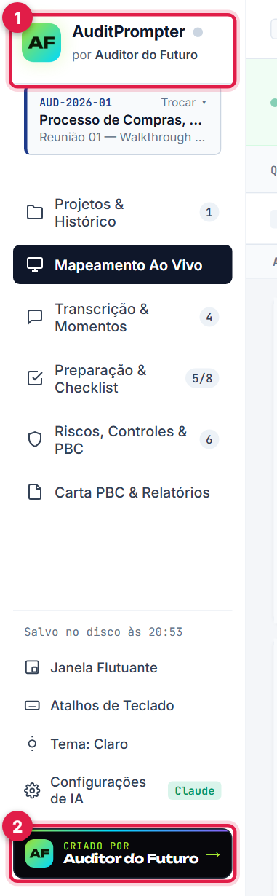

Clicar em qualquer um dos dois abre a janela com os treinamentos, a mentoria e os canais de contato:

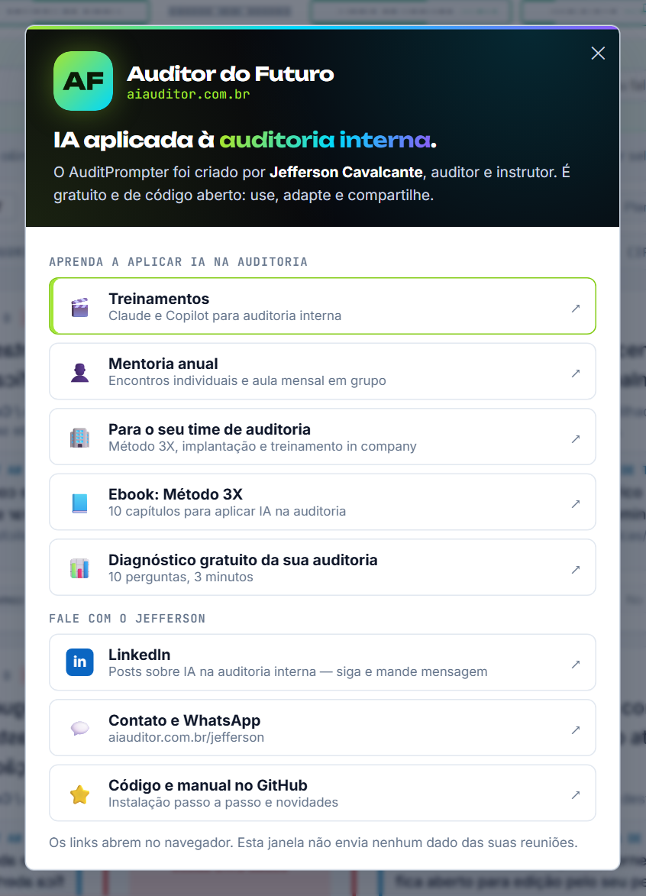

## 7.2 Treinamentos, mentoria e conteúdo

| O que é | Para quem | Link |
|---|---|---|
| **Treinamentos** | Quem quer aplicar Claude e Copilot na auditoria interna | https://aiauditor.com.br/cursos/ |
| **Mentoria anual** | Auditores que querem acompanhamento individual | https://aiauditor.com.br/mentoria/ |
| **Soluções para times** | Áreas de auditoria: Método 3X, implantação e in company | https://aiauditor.com.br/solucoes/ |
| **Ebook: Método 3X** | Quem quer começar lendo | https://ebook.aiauditor.com.br/ |
| **Diagnóstico gratuito** | Quem quer avaliar a auditoria antes de colocar IA | https://aiauditor.com.br/diagnostico/ |

## 7.3 Contato e redes

| Canal | Endereço |
|---|---|
| **LinkedIn** | https://www.linkedin.com/in/jefferson-pereira/ |
| **Site e contato por WhatsApp** | https://aiauditor.com.br/jefferson/ |
| **Código e novidades da ferramenta** | https://github.com/jeffersoncp21/auditprompter-ai |

> **Gostou da ferramenta?** Siga o Jefferson no LinkedIn para acompanhar novas versões e conteúdos sobre IA na auditoria interna, e compartilhe o link do GitHub com outros auditores.
